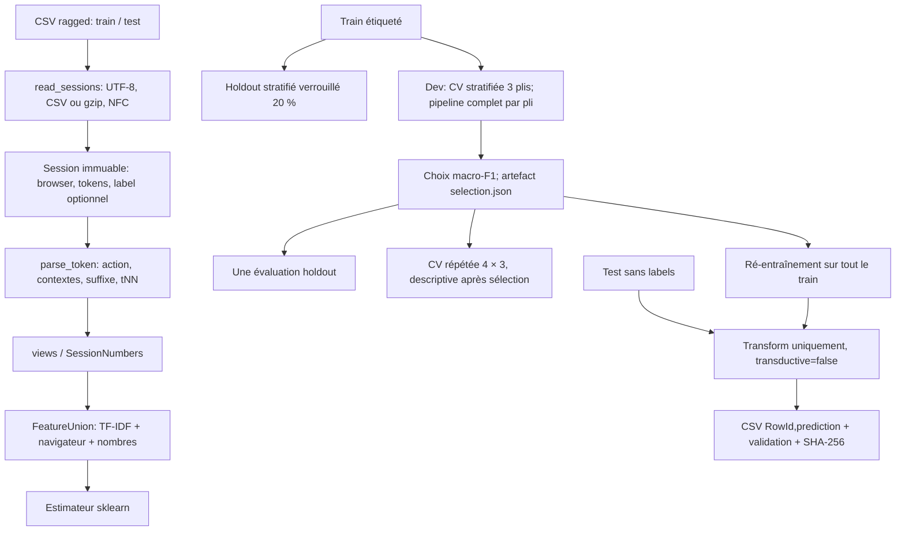

# Carnet technique — identification de sessions Copilote

> [!abstract] Objet du carnet
> Ce document est une note technique autonome et progressive sur le dépôt BE_ML : question étudiée, format réel, parseur, représentation, apprentissage, validation, résultats, interprétabilité, reproductibilité et limites. Les résultats chiffrés ci-dessous sont transcrits des artefacts existants `reports/results/*.json|csv`; ils n'ont pas été recalculés pour cette note.

> [!info] Légende des preuves
> - **[OBSERVÉ — code]** : directement implémenté dans les fichiers cités.
> - **[OBSERVÉ — artefact]** : valeur présente dans un résultat existant cité.
> - **[INTERPRÉTATION]** : explication plausible des mesures, non démontrée causalement.
> - **[NON ÉTABLI / NON EXÉCUTÉ]** : information inconnue, méthode absente ou vérification non faite.
>
> Les formules décrivent des définitions mathématiques ou le modèle visé; elles ne constituent pas à elles seules une preuve que les hypothèses statistiques sont satisfaites.

## Sommaire

1. [[#1. Question scientifique et contexte|Question et contexte]]
2. [[#2. Dépôt et chaîne de calcul|Dépôt et chaîne]]
3. [[#3. Données et unité d'observation|Données]]
4. [[#4. Grammaire des événements et parsing|Parsing]]
5. [[#5. Représentations et variables|Représentations]]
6. [[#6. Validation et contrôle des fuites|Validation]]
7. [[#7. Catalogue de modèles|Modèles]]
8. [[#8. Mesures et leur interprétation|Métriques]]
9. [[#9. Résultats vérifiés|Résultats]]
10. [[#10. Interprétabilité et analyse d'erreurs|Interprétabilité]]
11. [[#11. Reproductibilité et provenance|Reproductibilité]]
12. [[#12. Limites, risques et plan de suite|Limites et suite]]
13. [[#13. Glossaire|Glossaire]]
14. [[#14. Références|Références]]

---

## 1. Question scientifique et contexte

### 1.1 Tâche

**[OBSERVÉ — projet]** Une ligne de données correspond à une session d'utilisation de l'application Copilote, éditée par Infologic. Le problème d'apprentissage est de prédire le code utilisateur (variable de regroupement) à partir du navigateur et d'une séquence variable d'événements d'interface.

Formellement, chaque observation est une séquence de longueur variable et des métadonnées :

$$
  x_i = (b_i, e_{i1},\ldots,e_{iT_i}), \qquad y_i \in \{1,\ldots,K\},
$$

où $b_i$ est le navigateur, $e_{it}$ un événement texte, $T_i$ varie fortement selon la session et $K=247$ classes utilisateur. La sortie demandée est une classe, pas une durée, un score continu ou une série chronologique future.

**Pourquoi c'est intéressant :** un utilisateur peut avoir une empreinte comportementale dans les écrans, modules, actions, configurations et routines d'utilisation. Une telle empreinte peut rendre l'identification prédictive, mais ne prouve pas l'identité réelle ni le rôle métier. Le problème soulève aussi un risque de ré-identification à partir de journaux d'usage.

### 1.2 Critère de sélection

**[OBSERVÉ — configuration]** La métrique de sélection est `macro_f1` (`configs/default.yaml`). Le critère officiel du concours n'est pas confirmé dans les fichiers de décision et de progression; l'accuracy est aussi suivie systématiquement. Ne pas appeler macro-F1 « métrique Kaggle officielle » sans vérifier la page du concours.

**[OBSERVÉ — source du brief]** Le brief du cours décrit une compétition Kaggle, exige un rapport en français, et recommande une comparaison de modèles avec accuracy et F1. Voir [`PROMPT.md`](PROMPT.md), notamment ses sections contexte, mesures et livrables.

### 1.3 Ce qui est effectivement livré par le code

Chaîne visée : lecture ragged → parse sans perte → exploration → représentations sparse et statistiques → sélection CV de développement → holdout verrouillé → analyse post-sélection → ré-entraînement sur tout le train → prédiction et validation du CSV de soumission.

**[NON ÉTABLI]** Aucun score de leaderboard, preuve de téléversement à Kaggle/Moodle, date/cohorte représentative des logs, ni cible officielle ne sont documentés comme vérifiés.

---

## 2. Dépôt et chaîne de calcul

### 2.1 Carte du dépôt

| Rôle | Fichiers principaux |
|---|---|
| Instructions et contexte | [`AGENTS.md`](AGENTS.md), [`PROMPT.md`](PROMPT.md), [`PROGRESS.md`](PROGRESS.md) |
| Paramètres | [`configs/default.yaml`](configs/default.yaml), [`pyproject.toml`](pyproject.toml), [`uv.lock`](uv.lock) |
| Lecture et parsing | [`src/copilote/io.py`](src/copilote/io.py), [`src/copilote/tokens.py`](src/copilote/tokens.py) |
| Variables | [`src/copilote/features.py`](src/copilote/features.py), [`docs/FEATURES.md`](docs/FEATURES.md) |
| Modèles et expériences | [`src/copilote/models.py`](src/copilote/models.py), [`src/copilote/evaluate.py`](src/copilote/evaluate.py), [`docs/EXPERIMENTS.md`](docs/EXPERIMENTS.md) |
| Explicabilité et soumission | [`src/copilote/interpret.py`](src/copilote/interpret.py), [`src/copilote/predict.py`](src/copilote/predict.py) |
| Décisions et défense | [`docs/DECISIONS.md`](docs/DECISIONS.md), [`docs/DEFENSE.md`](docs/DEFENSE.md) |
| Mesures, figures, rapports | `reports/results/`, `reports/figures/`, `reports/latex/` |
| Tests | `tests/test_io_tokens.py`, `test_features.py`, `test_evaluation.py`, `test_interpret_predict.py` |

Le point d'entrée `python -m copilote.run_all <phase>` orchestre les phases; `make all` enchaîne lint, tests, pipeline puis notebook. L'orchestration se trouve dans [`src/copilote/run_all.py`](src/copilote/run_all.py) et le [`Makefile`](Makefile).

### 2.2 Vue de flux



**Lecture du schéma :** le test ne participe ni à l'ajustement du vocabulaire ni à la sélection. Le holdout est prélevé avant la sélection du modèle. Les résultats répétés calculés sur tout le train viennent après le verrouillage et sont explicitement descriptifs, et non une évaluation imbriquée sans biais.

---

## 3. Données et unité d'observation

### 3.1 Schéma logique

**[OBSERVÉ — code]** `Session` est une dataclass immuable avec `row_id`, `browser`, `tokens: tuple[str, ...]` et `label: str | None`. Le `row_id` conserve l'ordre initial, zéro-indexé en interne. Le lecteur n'étend pas chaque session dans une table rectangulaire remplie de valeurs manquantes. Voir [`io.py`](src/copilote/io.py).

| Jeu | Champs logiques | Nombre de sessions | Étiquette utilisateur |
|---|---|---:|---|
| Entraînement | `label, browser, event_1, …, event_T` | 3 279 | présente |
| Test | `browser, event_1, …, event_T` | 324 | absente |

Le fichier exemple de soumission impose `RowId,prediction` et des identifiants commençant à 1. Le prédicteur conserve l'ordre des lignes du test et vérifie l'en-tête, le nombre de lignes, les valeurs manquantes et l'appartenance des prédictions aux étiquettes d'entraînement (`data/sample_submission.csv`, [`predict.py`](src/copilote/predict.py)).

### 3.2 Taille et déséquilibre des classes

**[OBSERVÉ — artefact]** Le train compte 247 classes; leurs effectifs vont de 4 à 75, avec médiane 12, premier quartile 7 et troisième quartile 16. La moyenne est 13,2753 sessions par classe et l'écart-type 8,8624. Les plus grands effectifs cités sont `skm` 75, `slq` 71, `cjr` 46, `flj` 42 et `hjs` 37. Sources : [`loading.json`](reports/results/loading.json), [`eda.json`](reports/results/eda.json), [`session_statistics_train.csv`](reports/results/session_statistics_train.csv).

La distribution est très déséquilibrée : un modèle peut obtenir une accuracy acceptable en ignorant les classes rares tout en étant inutilisable pour elles. C'est la motivation de la macro-F1, de l'accuracy équilibrée et de l'expérience avec `class_weight="balanced"`.

### 3.3 Navigateurs

| Navigateur | Train | Test |
|---|---:|---:|
| Firefox | 1 466 | 147 |
| Chrome | 1 339 | 133 |
| Edge | 451 | 42 |
| Opera | 23 | 2 |

**[OBSERVÉ — artefact EDA]** Aucun utilisateur observé dans le train n'emploie plusieurs navigateurs (`eda.json`). Cette description n'établit ni que le navigateur identifie un individu, ni qu'il se généralisera dans une autre période. Les deux lignes Opera du test rendent toute comparaison de performance dans ce sous-groupe très incertaine.

### 3.4 Longueur et fréquence des événements

Les sessions sont lourdes en queue et ne sont pas toutes de longueur comparable.

| Mesure | Train | Test |
|---|---:|---:|
| Tokens, médiane | 423 | 450 |
| Tokens, moyenne | 850,24 | 818,45 |
| Tokens, maximum | 14 468 | 7 725 |
| Actions, médiane | 340 | 365 |
| Actions, maximum | 11 977 | 6 203 |
| Sessions sans événements | 1 | 0 |

Les quantiles p95 de longueur sont environ 2 900 tokens pour le train et 2 780,45 pour le test. Source : `session_statistics_train.csv`, `session_statistics_test.csv`; les descripteurs et figures sont répertoriés dans [`eda.json`](reports/results/eda.json).

Top actions observées dans le train : exécution bouton (510 645 occurrences), saisie champ (265 633), sélection écran (206 813), fermeture dialogue (171 026), affichage dialogue (168 928). Les comptes d'actions sont des occurrences, pas des sessions ni des utilisateurs.

### 3.5 Vocabulaire et dérive observée

**[OBSERVÉ — artefact]** Le vocabulaire d'événements distincts contient 9 445 types dans le train, 4 231 dans le test et 9 651 dans leur union; 206 types apparaissent uniquement au test. La fraction des occurrences de test hors vocabulaire train est 0,0010106457. Il n'y a pas de doublon exact de session rapporté ni de recouvrement exact train/test. Voir [`loading.json`](reports/results/loading.json) et [`eda.json`](reports/results/eda.json).

Les tests KS descriptifs de l'EDA ne concluent pas à une absence de décalage : par exemple la longueur-token a statistique KS 0,0491 (p=0,461), le nombre d'actions 0,0461 (p=0,542), et la fraction de suffixes 0,0759 (p=0,0635). Les valeurs p sont non corrigées et les sessions peuvent être dépendantes; une non-significativité n'est pas une preuve d'équivalence. Ces tests n'ajustent pas le modèle et ne servent pas à choisir des variables.

> [!warning] Protection des données
> Des traces détaillées d'utilisation logicielle peuvent révéler les habitudes et modules consultés d'une personne. Les codes de classes sont pseudonymes, pas anonymes par définition. Les exports locaux et exemples d'explication ne doivent pas être publiés sans vérifier le cadre de partage et le besoin de minimisation.

---

## 4. Grammaire des événements et parsing

### 4.1 Structure reconnue

Les chaînes combinent une action française, des annotations de contexte optionnelles et parfois un marqueur de temps :

```text
événement := action [ (écran) ... ] [ <configuration> ... ] [ $chaîne$ ... ]
             [suffixe terminal 1]
temps     := t suivi d'un ou plusieurs chiffres
```

Les parenthèses identifient un champ écran, les chevrons une configuration et les dollars une chaîne (chain). Plusieurs groupes d'un même type sont conservés. Les parenthèses peuvent être imbriquées, notamment dans des chemins Java.

**[OBSERVÉ — code]** `parse_token` normalise Unicode en NFC, reconnaît `tNN` uniquement si toute la chaîne correspond à `^t\d+$`, décompose les groupes équilibrés et reconstitue le token à partir des portions littérales et annotations. Le marqueur `1` n'est retiré que s'il est le dernier caractère de l'action après extraction des groupes; un chiffre intérieur ou un apostrophe ne sont pas supprimés. Voir [`tokens.py`](src/copilote/tokens.py) et tests dans [`test_io_tokens.py`](tests/test_io_tokens.py).

**[OBSERVÉ — artefact]** Le contrôle de chargement a parcouru l'union des tokens distincts train/test, avec zéro échec de reconstruction et deux tokens de contexte imbriqué comptés par l'artefact. Ce test est plus large que quelques exemples unitaires. Résultat : [`loading.json`](reports/results/loading.json).

### 4.2 Horloge : décision de représentation, pas sémantique garantie

Le code interprète la valeur numérique de `tNN` comme un nombre présumé de secondes. La décision documentée exclut le facteur ×5 évoqué dans le brief initial et somme les incréments positifs lorsqu'ils montent, en détectant un recul comme un reset potentiel. Source : [`DECISIONS.md`](docs/DECISIONS.md), décision D03; extraction dans [`features.py`](src/copilote/features.py).

**[OBSERVÉ]** Les marqueurs vus vont de `t5` à `t11790`, avec une médiane de 82 marqueurs par session train; l'écart positif moyen entre marqueurs est environ 4,78. Aucun reset n'a été observé dans les jeux résumés.

**[NON ÉTABLI]** Cela ne prouve pas que les valeurs sont des secondes réelles, que les marqueurs ont une périodicité constante, ni que leur différence mesure l'inactivité. Le projet précise explicitement qu'aucune durée exacte par action n'est revendiquée. On parlera de *proxys temporels* plutôt que de temps passé.

### 4.3 Propagation du contexte

`filled_context()` transporte écran/configuration/chaîne observés vers les actions suivantes dans la même session. Il ignore les marqueurs temporels, remet les champs à vide au démarrage serveur, et les réinitialise après fermeture de session.

**[INTERPRÉTATION / variante]** C'est l'hypothèse que les journaux omettent les contextes inchangés. Le sens métier du suffixe `1` et la règle réelle d'écriture des logs ne sont pas établis. La propagation est une famille candidate/ablation et non une vérité sur le logiciel.

---

## 5. Représentations et variables

### 5.1 Vues d'une session

`views()` construit des séquences déterministes locales à chaque ligne; elle n'apprend pas de statistiques à travers les sessions. Les familles implémentées sont :

| Famille | Construction | Intuition et limite |
|---|---|---|
| `raw` | Événements entiers exacts, en excluant `tNN` | Préserve action et contexte joint; haute dimension, catégories rares |
| `action` | Action sans groupe explicite et sans suffixe terminal `1` | Mutualise les écrans; peut effacer une identité de module |
| `screen`, `config`, `chain` | Valeurs de groupes explicites | Signature de modules/configuration, mais sémantique métier incomplète |
| `pairs` | Action associée à chaque groupe explicite | Représente une interaction action-contexte |
| `filled` | Événements avec contexte propagé dans la session | Hypothèse optionnelle décrite ci-dessus |
| `position` | Trois premières et trois dernières actions | Capture des routines d'entrée/sortie |
| `time` | Catégories de bins `floor(log2(1+t))` | Profil temporel grossier; pas de temps absolu |
| `browser` | Catégorie navigateur | Signal secondaire / filtre de candidats, pas identifiant unique |
| `numeric` | Longueur, diversité, répétition, horloge et fractions de contexte | Profil compact; corrélations fortes entre certaines mesures |
| `char` | N-grammes caractères 3–5 sur les événements bruts | Variante de robustesse lexicale, moins lisible |

Les familles réellement réunies dans le modèle final sont `raw` + `browser`. Le catalogue comprend d'autres variantes et ablations, pas toutes les familles simultanément par défaut. Voir `FAMILIES`, `views()` et `build_features()` dans [`features.py`](src/copilote/features.py), et [`FEATURES.md`](docs/FEATURES.md).

### 5.2 TF-IDF par session

Chaque session devient un document composé d'événements-token. Le tokenizer d'identité garde les limites d'événements; une action contenant des espaces reste un token complet. Les n-grammes 1–2 représentent à la fois fréquence et séquence adjacente d'événements. Le gagnant utilise la vue brute plus navigateur.

Dans un pli d'entraînement, pour un terme/événement $j$ dans la session $i$, le TF-IDF utilisé par scikit-learn avec TF sous-linéaire et IDF lissée peut s'écrire :

$$
\operatorname{tf}_{ij}=\begin{cases}1+\log(c_{ij}) & c_{ij}>0\\0 & c_{ij}=0\end{cases},
\qquad
\operatorname{idf}_{j}=\log\!\left(\frac{1+n}{1+\operatorname{df}_{j}}\right)+1,
$$

$$
z_{ij}=\operatorname{tf}_{ij}\operatorname{idf}_j,
\qquad
\widetilde{z}_i=\frac{z_i}{\lVert z_i\rVert_2}.
$$

Ici $c_{ij}$ est le nombre d'occurrences du token/gramme dans la session, $n$ le nombre de sessions d'entraînement du pli et $\operatorname{df}_j$ le nombre de sessions contenant le terme. Les paramètres par défaut de `TfidfVectorizer` incluent `min_df=2`, `max_features=60000`, `lowercase=False`, `norm="l2"`, `sublinear_tf=True`, `ngram_range=(1,2)` pour la vue brute. Les unigrammes navigateur ont `min_df=1`. Le vocabulaire, DF/IDF et la sélection de termes sont appris au `fit` du pli uniquement.

**Pourquoi ce choix?** Une action fréquente dans une session n'est pas forcément propre à l'utilisateur; l'IDF atténue les événements présents partout. La normalisation L2 réduit l'effet mécanique du nombre d'événements, utile face aux longueurs de sessions très variables. Les termes rares peuvent être discriminants mais sont contrôlés par `min_df` et `max_features`.

**Limites :** le TF-IDF perd l'ordre au-delà des petits n-grammes et n'encode pas une dynamique de séquence complète. La concatenation de blocs via `FeatureUnion` n'applique pas de coefficient d'équilibrage explicite entre `raw` et `browser`.

### 5.3 Résumés numériques

Le bloc numérique calcule entre autres : nombre de tokens/actions, nombre d'actions distinctes, entropie, marqueurs temporels et maximum, somme des incréments positifs, resets, statistiques d'écart, taux d'actions par durée-proxy, proportions de contextes explicites, taux de suffixe, contextes distincts et répétitions.

Transformation suivie dans le code :

$$
u_{ik}=\log(1+s_{ik}), \qquad
\widehat{u}_{ik}=\frac{u_{ik}-\mu_k^{(\text{pli})}}{\sigma_k^{(\text{pli})}},
$$

où $s_{ik}\geq0$ est un résumé déterministe de session. Le `log1p` est fixe; le `StandardScaler(with_mean=False)` est ajusté dans le pipeline et pli. `with_mean=False` préserve la représentation creuse.

Les mesures de longueur/action sont fortement redondantes : corrélation de Spearman `tokens`/`actions` 0,9985; certaines statistiques d'horloge dépassent 0,999. Une mesure constante comme le compteur de reset n'apporte pas de variation empirique dans ces données. Ces observations sont descriptives, ne prouvent pas que chaque variable soit inutile.

### 5.4 Figures exploratoires

Les figures ci-dessous illustrent les artefacts existants; elles ne remplacent pas leurs données source.

![[reports/figures/eda_overview.png]]
*Figure : distributions générales d'EDA (`reports/figures/eda_overview.png`; résultats numériques dans `eda.json`).*

![[reports/figures/feature_correlations.png]]
*Figure : corrélations de Spearman des descripteurs (`feature_correlations.png`). Corrélation n'implique pas relation causale ni redondance prédictive garantie.*

![[reports/figures/feature_projection.png]]
*Figure : projection SVD descriptive du train; le code couleur représente des catégories d'utilisateur. Une séparation visuelle sur les données ajustées n'est pas une validation hors-échantillon.*

**[OBSERVÉ — source]** ANOVA, Kruskal, tailles d'effet, correction Bonferroni, projection SVD et boxplots sont produits à des fins descriptives sur le train. Le code marque `descriptive_only: true`; aucun de ces tests sur le train entier ne choisit les colonnes du modèle. Des codes catégoriels sont utilisés pour le graphique de classes et ne doivent pas être interprétés comme ordonnés numériquement.

---

## 6. Validation et contrôle des fuites

### 6.1 Découpage

**[OBSERVÉ — code/configuration]** Graine globale 42; holdout stratifié de 20 % prélevé avant la recherche de modèles, soit 656 sessions, avec 2 623 sessions de développement. La sélection utilise StratifiedKFold à 3 plis, mélange activé et graine 42, sur le développement. Chaque candidat est un pipeline complet ré-ajusté à chaque pli. Paramètres : [`default.yaml`](configs/default.yaml); protocole détaillé dans [`evaluate.py`](src/copilote/evaluate.py) et [`EXPERIMENTS.md`](docs/EXPERIMENTS.md).

Chaque classe a au moins quatre sessions dans le jeu complet, permettant les plis stratifiés prévus. Les tailles des classes au sein de chaque partition peuvent toutefois rester très petites; les scores des classes rares sont instables.

### 6.2 Pourquoi le pipeline par pli est important

La transformation TF-IDF, le vocabulaire, le seuil `min_df`, la mise à l'échelle et la réduction SVD éventuelle sont apprises dans le `Pipeline` ajusté sur les seuls indices d'entraînement du pli. Les sessions de validation sont seulement transformées. Ainsi, un token propre à la validation ne peut pas agrandir le vocabulaire utilisé pour évaluer ce pli.

**[OBSERVÉ — tests]** `test_features.py` vérifie qu'un token/navigateur inconnu n'altère pas le vocabulaire ni les moyennes du scaler après `transform`; il teste aussi le clone non ajusté, les sessions vides et le reset du contexte entre sessions. Les tests de parsing vérifient la reconstruction, la grammaire imbriquée et l'absence de suppression de chiffres intérieurs. Voir [`test_features.py`](tests/test_features.py), [`test_io_tokens.py`](tests/test_io_tokens.py).

### 6.3 Rôle distinct de chaque évaluation

1. **CV développement (3 plis)** : choix piloté par macro-F1; source de sélection.
2. **Holdout verrouillé (20 %)** : une évaluation du modèle sélectionné après le choix.
3. **CV répétée (4 plis × 3 répétitions) sur le train complet** : mesure descriptive de stabilité après la sélection. Elle n'est ni nested CV ni estimation indépendante du processus complet de choix.
4. **Learning curve et analyses d'ablation** : diagnostics post-lock; ne doivent pas devenir une seconde opportunité informelle de sélectionner le modèle après observation du holdout.
5. **Test sans labels** : transformation/prédiction finale seulement. `transductive=false` dans le métadonné de soumission.

### 6.4 Calibration et précaution d'interprétation

`LinearSVC` ne fournit pas directement une probabilité. Le code convertit parfois ses scores de décision en softmax pour pouvoir calculer certains rangs et métriques; cela est étiqueté `uncalibrated_score_softmax`. Ce softmax est une transformation monotone utile pour classer les candidats dans une observation, mais n'est pas une probabilité calibrée.

La version calibrée utilise `CalibratedClassifierCV(method="sigmoid", cv=StratifiedKFold(3), ensemble=False)` ajustée sur le développement, puis évaluée sur le holdout. Cette calibration peut changer la distribution des scores et potentiellement l'argmax.

> [!warning] Divergence interne à ne pas masquer
> `docs/EXPERIMENTS.md` et `docs/DEFENSE.md` disent que la calibration réduit la log-loss sans changer la classe prédite. Pourtant `evaluate.py` calcule aussi les métriques de classe sur `argmax` des probabilités calibrées; l'artefact holdout rapporte accuracy inchangée mais macro-F1 et balanced accuracy différentes (0,9405 → 0,9309; 0,9466 → 0,9374). Sous réserve que ces métriques proviennent bien des mêmes 656 lignes et du même calcul, la variation de macro-F1 démontre que le vecteur de prédictions a changé pour au moins une ligne : l'affirmation documentaire « aucune classe ne change » est donc incompatible avec les métriques enregistrées. L'accuracy agrégée identique signifie seulement que le nombre total de prédictions correctes est identique. Comparer les vecteurs directement permettrait de compter et caractériser les changements.

### 6.5 Pas de résultat final indépendant imbriqué

Le holdout donne un point d'ancrage séparé, mais il ne mesure pas la variabilité de tout le processus d'optimisation. La CV répétée du meilleur modèle a lieu sur le train entier après sélection et est donc descriptive. Pour estimer sans biais une procédure qui choisit parmi les modèles, il faudrait une évaluation imbriquée (boucle interne de choix, boucle externe d'estimation) ou une réplication externe indépendante.

---

## 7. Catalogue de modèles

Le catalogue est défini dans [`models.py`](src/copilote/models.py). Les candidats partagent les familles `raw` + `browser` à moins qu'une ablation ne les remplace. Les modèles qui nécessitent une entrée dense / à faible dimension utilisent SVD 64 composantes puis mise à l'échelle (MLP et HistGradientBoosting). Les dépendances optionnelles XGBoost, LightGBM, SHAP et les modèles neuronaux de séquence ne font pas partie de l'implémentation exécutée décrite ici.

| Famille | Modèles présents | But / paramètres visibles |
|---|---|---|
| Références | majorité, hasard stratifié, navigateur | Fixer des repères faibles. Le classifieur navigateur estime des fréquences conditionnelles et utilise le prior pour un navigateur inconnu. |
| Linéaires sparse | `LinearSVC`, OvR LogisticRegression, `SGDClassifier` hinge/log, Ridge, ComplementNB, BernoulliNB | Exploiter un grand espace de tokens sparse avec régularisation. SVM final : `C=1`, balanced, `max_iter=4000`, dual auto. |
| SVM non linéaires | `SVC` RBF (`C=10`) et polynomial degré 2 (`C=10`) | Tester des frontières non linéaires coûteuses dans le grand espace. |
| Arbres | DecisionTree profondeur max 30 / feuille min 2; RandomForest et ExtraTrees (150 arbres, max_features=sqrt); HistGradientBoosting (20 itérations, 7 feuilles) | Comparer règles et interactions. HistGradientBoosting utilise la représentation réduite SVD. |
| Réseau dense | MLP (128 unités, alpha 0,01, max 120 itérations) | Tester une non-linéarité dense après SVD 64 + scaling; pas de réseau séquentiel entraîné. |
| Similarité | kNN, 3 voisins, distance cosinus | Comparaison de voisinage en espace TF-IDF, recherche brute. |
| Combinaisons | vote dur, vote doux, vote pondéré, stacking | Tester diversité des erreurs; ne sont retenus que si le gain CV dépasse le seuil défini. |
| Régularisation additionnelle | SGD logistique L1 ou elastic-net, elastic-net `l1_ratio=0,15`; variantes TF-IDF binaire | Examiner parcimonie et type de pondération. |

Les votes doux/pondéré combinent LogisticRegression, ComplementNB et forêt; le vote dur combine SVM linéaire, ComplementNB et forêt. Le stacking combine SGD elastic-net et ComplementNB, avec régression logistique méta-estimateur et CV stratifiée interne à deux plis. Les résultats rapportés pour ces essais ne montrent pas d'amélioration suffisamment grande.

### 7.1 Pourquoi LinearSVC convient a priori

Avec plus de 9 000 événements distincts, des milliers de variables peuvent être créées, mais chaque session n'en active qu'une faible partie. TF-IDF produit une matrice sparse de très grande dimension et faible densité. Un modèle linéaire régularisé peut exploiter des indices individuels (écrans/configurations) et des n-grammes sans matérialiser toutes les combinaisons d'interactions.

Pour une classe $k$ opposée aux autres, le score linéaire est :

$$
f_k(x)=w_k^\top x+b_k, \qquad \widehat{y}=\arg\max_{k=1,\dots,K} f_k(x).
$$

**Description théorique du SVM linéaire** (marge souple, pénalité L2 et perte hinge quadratique comme exposées par LinearSVC) :

$$
\min_{w_k,b_k}\;\frac{1}{2}\lVert w_k\rVert_2^2
+ C\sum_{i=1}^{n}\alpha_{i,k}\,\max\!\left(0,1-y_{i,k}(w_k^\top x_i+b_k)\right)^2,
$$

où $y_{i,k}\in\{-1,+1\}$ représente la classe contre le reste et $\alpha_{i,k}$ un poids de classe/observation. Il s'agit d'une description mathématique du principe; le solveur numérique exact, son chemin d'optimisation et les tolérances effectives dépendent de scikit-learn/liblinear. Ce n'est pas un entraînement par epochs/minibatches et il n'y a pas de taux d'apprentissage SVM à interpréter.

### 7.2 Déséquilibre et `class_weight="balanced"`

Une pondération équilibrée donne davantage de poids aux erreurs sur les classes rares, au prix potentiel d'une baisse de performance sur des classes majoritaires. Dans la convention usuelle de scikit-learn, le poids est inversement proportionnel à la fréquence de classe :

$$
  w_k \propto \frac{n}{K\,n_k},
$$

où $n_k$ est l'effectif de classe $k$. Les poids sont calculés sur les seules étiquettes du fit en cours. La comparaison empirique `linear` contre `linear_balanced` est présentée en section Résultats.

### 7.3 Ce qui n'a pas été implémenté

**[NON EXÉCUTÉ]** XGBoost/LightGBM, réseaux RNN/CNN/transformer, augmentation par fenêtres, transition Markov, hiérarchie de préfixes de modules, target encoding, SHAP/LIME, apprentissage pseudo-étiqueté et rééchantillonnage synthétique ne sont pas le modèle final documenté ici. Ils peuvent constituer des pistes, mais aucun résultat ne doit leur être attribué.

---

## 8. Mesures et leur interprétation

### 8.1 Confusion multiclasse

Pour chaque classe $k$, $TP_k$ est le nombre de vrais positifs, $FP_k$ de faux positifs et $FN_k$ de faux négatifs.

$$
  P_k=\frac{TP_k}{TP_k+FP_k},\quad
  R_k=\frac{TP_k}{TP_k+FN_k},\quad
  F1_k=\frac{2P_kR_k}{P_k+R_k}.
$$

Les dénominateurs nuls sont traités par `zero_division=0` dans `evaluate.py`.

### 8.2 Exactitude (accuracy)

$$
  \operatorname{Accuracy}=\frac{1}{N}\sum_{i=1}^N\mathbf{1}(\widehat y_i=y_i).
$$

Chaque session pèse pareil. Avec classes rares, une forte exactitude peut cacher une classe ignorée.

### 8.3 F1 macro et F1 pondérée

$$
  F1_{macro}=\frac{1}{K}\sum_{k=1}^{K}F1_k,
  \qquad
  F1_{weighted}=\sum_{k=1}^{K}\frac{n_k}{N}F1_k.
$$

La macro-F1 accorde un poids égal à chaque classe effectivement évaluée; elle rend visibles les mauvais résultats sur petites classes. La F1 pondérée donne davantage de poids aux grandes classes et ressemble donc davantage à une moyenne orientée session. Elles sont deux vues différentes, pas deux mesures interchangeables.

### 8.4 Exactitude équilibrée

$$
  BA=\frac{1}{K}\sum_{k=1}^{K}R_k.
$$

La balanced accuracy moyenne les rappels par classe. Ce n'est pas la moyenne des F1 par classe : elle ne prend pas directement en compte la précision.

### 8.5 Top-k

$$
  TopK=\frac{1}{N}\sum_i\mathbf{1}\{y_i\in\text{les }k\text{ classes au score le plus élevé pour }x_i\}.
$$

Top-3/Top-5 mesurent si la classe vraie reste parmi quelques candidats plausibles. C'est pertinent pour l'analyse de tri, mais le format de soumission contient une seule classe et ces métriques ne sont pas équivalentes à l'accuracy.

### 8.6 Log-loss

Pour une distribution de probabilités $p_{ik}$ sur les classes :

$$
  L=-\frac{1}{N}\sum_i\log p_{i,y_i}.
$$

La pénalité augmente fortement quand la classe correcte reçoit une probabilité proche de zéro. La log-loss n'a d'interprétation probabiliste convaincante que si les probabilités ont un sens; le softmax de marges d'un SVM n'est pas calibré par défaut.

### 8.7 Calibration, ECE et couverture

Pour chaque ligne, la confiance top-label est $c_i=\max_k p_{ik}$; la correction est $a_i=\mathbf{1}(\arg\max p_i=y_i)$. Avec des intervalles de confiance $B_m$, l'Expected Calibration Error est estimée par :

$$
 ECE=\sum_m\frac{|B_m|}{N}\left|\operatorname{acc}(B_m)-\operatorname{conf}(B_m)\right|.
$$

L'implémentation utilise dix bins fixes sur [0,1], avec le bord supérieur inclus dans le dernier. L'ECE dépend du nombre et des limites des bins; ce n'est pas une propriété parfaitement stable de la distribution.

La **couverture** est la proportion de lignes retenues si l'on abstient sur les confiances les plus faibles; l'exactitude à couverture partielle montre le compromis si un humain devait examiner les cas rejetés. Ce seuil n'est pas employé pour les prédictions de soumission.

### 8.8 Exemple jouet (non issu du projet)

Supposons trois classes A, B, C et une classe A de 10 sessions, dont 8 sont correctement reconnues; le modèle prédit A 8 fois correctement, mais produit deux faux positifs A qui appartenaient à B.

- Pour A : précision $8/(8+2)=0,8$, rappel $8/10=0,8$, donc F1$_A=0,8$.
- Si B et C sont mal reconnues, accuracy peut rester élevée si A domine, alors que macro-F1 baisse car chaque F1 classe est moyennée sans pondération.
- Cet exemple est uniquement pédagogique et ne décrit aucun effectif réel de Copilote.

### 8.9 Mesures absentes ou non pertinentes ici

ROC-AUC et PR-AUC ne sont pas des métriques centrales dans le protocole multiclasses documenté; elles ne figurent pas dans la sortie `scores()`. MAE/RMSE sont des mesures de régression et ne conviennent pas à une étiquette nominale d'utilisateur. Le temps rapporté est un temps d'ajustement moyen par pli, pas un benchmark complet de prédiction ou de mémoire.

---

## 9. Résultats vérifiés

> [!important] Nature des résultats
> Les nombres ci-dessous viennent des artefacts présents dans `reports/results/` et des synthèses de `docs/EXPERIMENTS.md`. Le dépôt n'étant pas propre et les empreintes de code variant entre certains artefacts, ces mesures sont présentées comme résultats **existants dans le workspace**, pas comme une reconstruction fraîche d'un commit unique immuable. Voir [[#11. Reproductibilité et provenance]].

### 9.1 Sélection sur le développement — CV stratifiée 3 plis

La sélection optimise la macro-F1. Tableau transcrit de [`EXPERIMENTS.md`](docs/EXPERIMENTS.md) et des artefacts de sélection (`selection.json`, résultats individuels dans `reports/results/experiments/`). Valeurs : moyenne ± écart-type entre plis.

| Candidat | Macro-F1 dev | Lecture |
|---|---:|---|
| `linear_balanced` | 0,9434 ± 0,0160 | Linéaire, `raw` + navigateur, poids équilibrés; candidat retenu |
| `linear_C2` | 0,9350 ± 0,0064 | Linéaire, régularisation comparée |
| `linear_no_time` | 0,9273 ± 0,0117 | Ablation temporelle |
| `linear_trigrams` | 0,9255 ± 0,0149 | N-grammes jusqu'à 3 |
| `linear` | 0,9232 ± 0,0106 | Linéaire sans poids équilibrés |
| `mlp` | 0,8966 ± 0,0136 | MLP sur la représentation réduite |
| `linear_characters` | 0,8665 ± 0,0174 | N-grammes de caractères |
| `forest` | 0,8441 ± 0,0088 | Forêt aléatoire |
| `linear_no_context` | 0,7840 ± 0,0235 | Forte ablation de contexte |
| `linear_numeric` | 0,2909 ± 0,0067 | Variables numériques + navigateur seulement |
| `stacking` | 0,1794 ± 0,0084 | Empilement testé, faible ici |
| `tree` | 0,1838 ± 0,0122 | Arbre de décision |
| `browser` | 0,0053 ± 0,0000 | Navigateur seul |
| `majority` | 0,0002 ± 0,0000 | Classe majoritaire seule |

La coupure « meilleur moins un écart-type » rapportée est 0,9274; le modèle retenu est `linear_balanced`. La règle codée favorise le candidat de complexité minimale dans cette bande; les votes/stacking nécessitent un gain supérieur à l'écart-type du modèle retenu. Les éléments de sélection sont dans [`selection.json`](reports/results/selection.json).

**Interprétation :** le résultat numérique le plus net est la valeur prédictive des événements bruts et de leur contexte. L'ablation sans contexte est moins bonne; toutefois la famille brute conserve action et contexte ensemble, donc cette ablation n'isole pas parfaitement chaque type de contexte.

### 9.2 Holdout verrouillé — 656 sessions

| Métrique | SVM équilibré, marges-softmax non calibrées | SVM calibré sigmoïde |
|---|---:|---:|
| Accuracy | 0,9512 | 0,9512 |
| Macro-F1 | 0,9405 | 0,9309 |
| F1 pondérée | 0,9470 | non indiqué dans le tableau source |
| Balanced accuracy | 0,9466 | 0,9374 |
| Top-3 | 0,9893 | non indiqué dans le tableau source |
| Top-5 | 0,9909 | non indiqué dans le tableau source |
| Log-loss | 4,1123 | 0,3235 |

Source : [`holdout.json`](reports/results/holdout.json), résumé dans [`EXPERIMENTS.md`](docs/EXPERIMENTS.md). Le nombre d'exemples est 656. La baisse forte de log-loss après calibration indique que les probabilités calibrées assignent en moyenne plus de masse à la classe vraie. L'accuracy est identique à quatre décimales, mais macro-F1 et balanced accuracy baissent; si les deux branches évaluent bien les mêmes lignes, au moins une étiquette prédite a changé. Une comparaison directe établirait combien et lesquelles.

La macro-F1 holdout est proche de la CV développement mais ce sont des estimations sur des partitions et avec des incertitudes différentes. Le holdout n'est pas le test Kaggle.

### 9.3 CV répétée — entraînement complet, descriptive après sélection

| Modèle | Macro-F1 moyenne ± écart-type | Accuracy moyenne |
|---|---:|---:|
| `linear_balanced` | 0,9585 ± 0,0085 | 0,9661 |
| `linear` non équilibré | 0,9481 ± 0,0067 | 0,9611 |
| `sgd` hinge | 0,9337 ± 0,0097 | non repris dans la synthèse |
| `hard_vote` | 0,9115 ± 0,0116 | non repris dans la synthèse |
| `mlp` | 0,9115 ± 0,0084 | non repris dans la synthèse |
| SVM polynomial | 0,9025 ± 0,0107 | non repris dans la synthèse |
| SVM RBF | 0,8963 ± 0,0104 | non repris dans la synthèse |
| Forêt aléatoire | 0,8789 ± 0,0156 | non repris dans la synthèse |
| ComplementNB | 0,7132 ± 0,0160 | non repris dans la synthèse |
| Logistic OvR | 0,6388 | non repris dans la synthèse |
| Arbre | 0,1973 | non repris dans la synthèse |
| Stacking | 0,2811 | non repris dans la synthèse |
| Vote doux | 0,8752 | non repris dans la synthèse |

Source : [`model_comparison.csv`](reports/results/model_comparison.csv), qui contient moyennes, écarts-types et temps de fit par pli. Le tableau est descriptif : la sélection a eu lieu avant sur le développement; ne pas l'interpréter comme un benchmark impartial de toutes les procédures de choix.

Les baselines rapportées sur cette CV répétée ont accuracy / macro-F1 : majoritaire 0,02287 / 0,000181; hasard stratifié 0,00640 / 0,00409; navigateur 0,05093 / 0,005265. Elles confirment que les seules séquences portent la majeure partie du signal prédictif mesuré.

Le temps moyen d'ajustement indiqué pour `linear_balanced` est d'environ 3,355 secondes par pli dans le CSV d'essais. Il dépend de la machine, du nombre de threads et de la version logicielle; aucun benchmark mémoire/latence de service n'est établi.

### 9.4 Généralisation selon la longueur

Sur le holdout, l'accuracy du SVM augmente avec la longueur de session :

| Tokens | Accuracy SVM | n |
|---|---:|---:|
| [0, 100) | 0,9024 | 41 |
| [100, 500) | 0,9226 | 323 |
| [500, 2 000) | 0,9867 | 226 |
| [2 000, ∞) | 1,0000 | 66 |

La forêt est inférieure dans ces groupes (respectivement 0,8049; 0,8731; 0,9735; 0,9848). Ces sous-groupes sont descriptifs; les extrêmes comportent peu d'observations et ne sont pas une comparaison de modèles conçue indépendamment.

![[reports/figures/learning_curve.png]]
*Figure : learning curve post-sélection (`learning_curve.json`). À 853, 1 583 et 2 623 sessions d'apprentissage, le macro-F1 train est respectivement 1,0000, 0,9999 et 0,9998; le macro-F1 holdout est 0,8901, 0,9079 et 0,9405. Diagnostic post-lock, pas outil de sélection.*

### 9.5 Résultats probabilistes et incertitude

`interpretability.json` rapporte ECE de confiance d'environ 0,934 pour le softmax non calibré des marges SVM, 0,137 pour le modèle calibré et 0,505 pour la forêt. Pour le SVM non calibré, les marges softmax s'accumulent dans le bin de confiance [0,0,1), moyenne de confiance ≈0,0177 malgré une accuracy holdout d'environ 0,951; ce n'est pas une bonne probabilité de confiance.

La log-loss native du SVM (4,1123) est donc à interpréter avec cette réserve. La log-loss calibrée (0,3235) et l'ECE plus basse sont favorables sur ce holdout, mais les petits effectifs par classe et la réutilisation indirecte du développement pour ajuster la calibration imposent de ne pas promettre la même calibration sur une autre cohorte.

### 9.6 Effet des familles et ablations

Dans la CV de développement, retirer le contexte (variante `linear_no_context`) donne macro-F1 0,7840 au lieu de 0,9434 pour le modèle retenu; la comparaison `linear` vs `linear_without_browser` rapporte une perte d'environ 0,036 après retrait du navigateur dans la synthèse d'interprétabilité, et le retrait des unigrammes environ 0,049. Voir `selection.json`, `interpretability.json` et [`EXPERIMENTS.md`](docs/EXPERIMENTS.md).

Ces ablations décrivent la dépendance du modèle aux informations supprimées; elles ne mesurent pas un effet causal. Les variantes ne sont pas nécessairement comparées via un plan factoriel complet, et les familles peuvent être redondantes.

---

## 10. Interprétabilité et analyse d'erreurs

### 10.1 Importance prédictive groupée

La permutation groupée remplace les colonnes d'une famille par les valeurs de sessions réordonnées ensemble, puis mesure la perte de macro-F1. Elle préserve ainsi la dépendance interne au bloc mieux qu'une permutation indépendante de chaque colonne.

| Modèle | Famille | Perte moyenne macro-F1 ± écart-type |
|---|---|---:|
| Modèle retenu | `raw` | 0,933314 ± 0,003242 |
| Modèle retenu | `browser` | 0,113299 ± 0,00855 |
| Forêt | `raw` | 0,87919 (écart-type non repris ici) |
| Forêt | `browser` | 0,09292 (écart-type non repris ici) |

Source : [`interpretability.json`](reports/results/interpretability.json). Le macro-F1 de départ du SVM est ≈0,9405, donc la destruction du bloc `raw` retire pratiquement tout le signal, tandis que le navigateur est un apport secondaire. La permutation n'est pas une estimation de contribution causale; une grande perte peut aussi refléter la substitution d'un bloc corrélé.

### 10.2 Explication locale linéaire

Pour une classe prédite $k$ et un vecteur TF-IDF $x$, la marge s'écrit :

$$
  f_k(x)=b_k+\sum_j x_jw_{kj}.
$$

Le produit $x_jw_{kj}$ donne une décomposition exacte du score linéaire prédit en contributions des variables actives et intercept. Il explique la marge pour cette classe dans ce codage; il ne prouve pas qu'un événement ait causé le comportement de l'utilisateur. Un coefficient négatif ou une contribution à une classe n'est pas en soi une règle métier générale.

### 10.3 Forêt et arbre illustratif

La forêt donne des probabilités de vote; le code attribue le changement de probabilité le long d'un chemin d'arbre comme somme d'incréments, avec le prior racine. Les tests vérifient que la somme reconstruit la probabilité prédite. C'est une décomposition exacte du chemin de l'arbre/forêt, **pas** des valeurs SHAP et pas une explication causale.

L'arbre peu profond de profondeur 2 dessiné dans `pruned_tree.png` ne remplace pas le modèle sélectionné. Son rôle est pédagogique; accuracy holdout dans l'artefact ≈0,0351. Les importances d'impureté de forêt sont marquées comme biaisables dans le code et ne doivent pas être lues comme un classement neutre.

![[reports/figures/pruned_tree.png]]
*Figure : arbre de profondeur 2 sur les statistiques numériques, illustration seulement.*

### 10.4 Erreurs et sous-groupes

- La paire de confusion la plus fréquente dans le holdout est `skm → slq`, deux cas; toutes les paires maximales comptent au plus deux cas (`interpretability.json`). Les codes proches ne permettent pas d'inférer des rôles identiques.
- Exactitude par navigateur rapportée : Firefox 0,9553 (n=291), Chrome 0,9333 (n=270), Edge 0,9889 (n=90), Opera 1,0000 (n=5). Ces groupes ne sont ni équilibrés ni assez grands pour conclure à une équité entre navigateurs.
- Un cas confident mais faux dans les diagnostics est ligne 2049 du jeu de train réservé au holdout, vérité `iyf`, prédiction `cjr`, confiance de marge-softmax 0,8629. Identifiants pseudonymes et index locaux : ne pas traiter cette anecdote comme un cas représentatif, et ne pas exporter sans nécessité.
- La distribution de longueurs indique que les sessions courtes sont plus difficiles, avec n=41 pour moins de 100 tokens; une approche de rejet humain serait à étudier séparément.

![[reports/figures/confidence.png]]
*Figure : fiabilité et couverture; lire avec le statut calibré/non-calibré de chaque courbe.*

---

## 11. Reproductibilité et provenance

### 11.1 Reproduction prévue

Le dépôt épingle ses dépendances via `uv.lock` et `requirements.txt`, utilise seed 42 et place les données brutes localement dans `data/`, exclues des livrables futurs selon [`README.md`](README.md). Les fichiers bruts sont en lecture seule pour ce travail.

```bash
uv sync --python 3.13 --locked
make test
make lint
make eda
make fast
make all
```

`make all` lance lint/tests, l'EDA, features, sélection/évaluations, interprétabilité, prédictions, rapport puis exécute le notebook. Ces commandes reconstruisent des artefacts; le notebook principal est `notebooks/copilote.ipynb`. **Ne pas lancer `make all` comme simple vérification documentaire** si le notebook ou les résultats existants sont des changements utilisateurs à préserver.

**[OBSERVÉ — progression historique]** `PROGRESS.md` déclare des gates réussis sur Python 3.13.13 et mentionne Python 3.14.7 disponible mais non vérifié dans la pipeline. Il rapporte aussi que `make all`, pytest et ruff ont passé lors du travail précédent. Ces lignes sont une trace documentaire antérieure, pas une nouvelle exécution dans le cadre de cette note.

**[NON EXÉCUTÉ pour cette note]** Aucun pipeline, test, lint, notebook ou entraînement n'a été relancé pendant la rédaction, afin d'éviter d'écraser des expériences/figures/notebooks déjà modifiés. La validité de ce document a été vérifiée sans régénérer les artefacts de modèles.

### 11.2 Provenance technique attendue

`settings.provenance()` consigne les hashes de configuration, sources, données train/test, version Python, commit et état dirty. `evaluate.cache_signature()` couvre configuration, hash du train, `uv.lock` et modules prédictifs; le code invalide le cache lorsque cette signature diffère. La soumission possède un sidecar avec signature, modèle, nombre de lignes, en-tête, `transductive=false` et SHA-256.

### 11.3 Limite de cohérence constatée dans les artefacts actuels

**[OBSERVÉ — workspace]** Le dépôt était déjà modifié au début de la rédaction : plusieurs sources (EDA, interprétation, rapport), résultats/figures et notebooks historiques sont marqués comme modifiés; `PROMPT.md` était un fichier non suivi. Les sources de la branche actuelle ne doivent donc pas être confondues avec une photographie propre du commit enregistré dans tous les sidecars.

Les sidecars existants associent des artefacts à des révisions différentes (par ex. hashes/commits différents entre chargement, EDA et sélection-évaluation-soumission). Cela signifie que les nombres restent traçables à leurs fichiers `reports/results`, mais qu'on ne peut pas garantir, à partir du seul état présent, que chaque figure, JSON et version de code a été produit exactement par un même snapshot immuable. Toute présentation académique devrait conserver cette réserve, puis créer ultérieurement une exécution propre et signée si une reproduction intégrale est nécessaire.

### 11.4 Livrable local de prédiction

Le sidecar `reports/results/submission.json` rapporte une soumission locale validée de 324 lignes, colonnes `RowId,prediction`, IDs à base 1 et `transductive=false`; le fichier CSV et son SHA-256 sont référencés dans ce sidecar. Ce statut signifie validation locale de schéma, pas preuve de dépôt sur une plateforme externe.

---

## 12. Limites, risques et plan de suite

### 12.1 Limites scientifiques/statistiques

1. **Classes rares.** Quatre observations seulement pour la classe la plus petite; les partitions par classe sont fragiles et macro-F1 par classe peut varier beaucoup.
2. **Taille du holdout et test final.** 656 holdout et 324 sessions de test : quelques cas déplacent les scores; intervalles d'incertitude par bootstrap stratifié ou réplications externes ne sont pas fournis.
3. **Sélection non imbriquée.** Le repeated CV complet est post-sélection et descriptif; il ne corrige pas l'optimisme du choix parmi candidats.
4. **Confiance native inadéquate.** Softmax de marges non calibré, log-loss/ECE natifs trompeurs. La calibration est évaluée sur un unique holdout.
5. **Dérive et temporalité.** Date, période, cohorte, changement de version du logiciel et politique de session non renseignés; pas de validation temporelle disponible.
6. **Sémantique logs.** Unité de `tNN`, suffixe `1`, et contexte propagé restent des hypothèses. Aucune durée par action ne doit être revendiquée.
7. **Dépendances intra-utilisateur.** Les sessions du même utilisateur sont naturellement corrélées. Le split aléatoire par session répond à la question de généralisation à de nouvelles sessions d'utilisateurs déjà présents, pas à l'identification d'un nouvel utilisateur sans sessions étiquetées.
8. **Métrique officielle.** Macro-F1 a été choisie pour le déséquilibre; métrique Kaggle exacte non vérifiée.
9. **Interprétabilité.** Importance permutationnelle, coefficients et chemins sont spécifiques au modèle et aux variables; aucun effet causal n'est mesuré.
10. **Provenance.** L'état sale et les signatures hétérogènes empêchent d'affirmer que le snapshot complet est reproduit par le workspace actuel sans nouvelle exécution contrôlée.
11. **Coût système.** Temps moyen de fit par pli disponible, mais pas de mesure mémoire, coût de prédiction, latence de production ni benchmark sur matériel cible.

### 12.2 Plan priorisé — prochaines expériences, toutes non exécutées

| Priorité | Travail proposé | Pourquoi / critère d'acceptation |
|---:|---|---|
| 1 | Vérifier la métrique officielle et la ligne de soumission auprès de la source du concours; demander à l'humain les seules métadonnées de TD/équipe manquantes. | Aligner le critère de choix et le format; conserver la sélection CV et ne pas tuner au leaderboard. |
| 2 | Refaire une exécution complète depuis un état propre et archiver code/config/données-hash/versions/signatures ensemble. | Établir qu'un snapshot déterminé régénère exactement les tableaux et sidecars; rendre explicites tout écart. |
| 3 | Évaluer le processus de choix en nested CV ou en répétant à l'intérieur de chaque outer fold la sélection complète. | Obtenir une estimation moins optimiste de la performance de sélection, plutôt que de re-citer la CV post-sélection. |
| 4 | Ajouter intervalles bootstrap stratifiés au niveau session et résultats macro-F1 par classe avec effectifs. | Exposer l'incertitude et les classes rares; ne pas cacher des écarts derrière le seul score moyen. |
| 5 | Tester une validation temporelle/cohorte si des dates deviennent disponibles; clarifier avant tout split groupé l'objectif de généralisation et la cible. | Un split par utilisateur laisserait, pour une classification fermée, des classes inconnues à l'entraînement; il n'est donc pas une validation interchangeable du problème actuel. Des métadonnées de cohorte/temps aideraient plutôt à mesurer le changement de période. |
| 6 | Vérifier explicitement la différence de prédiction calibrée/non calibrée et produire une courbe de fiabilité avec intervalles. | Résoudre la divergence documentaire; mesurer calibration hors échantillon de façon prudente. |
| 7 | Comparer par ablation contrôlée les seuls champs écran/config/chaîne, suffixe, timing-proxy et contexte rempli avec variantes pré-déclarées. | Séparer mieux le signal des représentations sans prétendre à un effet causal. |
| 8 | Mesurer ressources/latence et examiner une stratégie humaine de revue des sessions courtes. | Évaluer la faisabilité d'usage, distincte de l'accuracy de classification offline. |
| 9 | Faire une revue de minimisation/anonymisation avant toute diffusion des événements et explications de ligne. | Réduire le risque de ré-identification induit par des traces détaillées. |

> [!note] Pas de résultats anticipés
> Aucun gain n'est prédit pour ces pistes. Ce sont des travaux futurs à mesurer avec le protocole de validation établi.

---

## 13. Glossaire

| Terme | Définition dans ce projet |
|---|---|
| Session | Ligne d'événements provenant d'un utilisateur, variable en longueur; unité de partitionnement actuelle. |
| Ragged | Séquences de longueurs inégales, conservées en tuples plutôt que complétées par des colonnes vides. |
| Token | Chaîne d'événement d'interface, avec ou sans annotations de contexte. |
| IDF | Pondération inverse de fréquence documentaire qui réduit le poids des termes présents dans de nombreuses sessions. |
| TF-IDF | Pondération locale de fréquence par IDF, normalisée ici en L2. |
| N-gramme | Séquence de n événements consécutifs; limite l'ordre conservé à une fenêtre de n événements. |
| Sparse | Matrice ne stockant que les entrées non nulles; adaptée aux événements peu fréquents. |
| Pli (fold) | Portion d'entraînement/validation d'une CV; les transformations apprises doivent être ajustées sur l'entraînement du pli. |
| Holdout | Partition laissée hors de la sélection, évaluée une fois après gel du modèle. |
| Macro-F1 | Moyenne non pondérée des F1 de classes; sensible aux classes rares. |
| Calibration | Accord entre confiance annoncée et fréquence observée d'exactitude. |
| OOV | Token observé dans le test qui n'existe pas au vocabulaire ajusté sur le train. |
| Transduction | Usage du test pour ajuster la représentation; explicitement désactivé dans la soumission actuelle. |
| Provenance | Empreintes de configuration, sources, données et environnement associées aux artefacts. |

---

## 14. Références

### Références internes et traçabilité

- [`PROMPT.md`](PROMPT.md) — brief du cours et description initiale des données; certaines hypothèses de ce brief sont ensuite corrigées ou laissées comme hypothèses dans `DECISIONS.md`.
- [`docs/DECISIONS.md`](docs/DECISIONS.md) — format de soumission, hypothèses temporelles, protocole et calibration.
- [`docs/FEATURES.md`](docs/FEATURES.md) — familles de variables et tests anti-fuite.
- [`docs/EXPERIMENTS.md`](docs/EXPERIMENTS.md) — sélection, holdout, CV répétée et résumés des résultats.
- [`docs/DEFENSE.md`](docs/DEFENSE.md) — préparation à la soutenance et limites annoncées.
- [`reports/results/`](reports/results/) — source numérique des résultats déjà produits; notamment `loading.json`, `eda.json`, `features.json`, `selection.json`, `holdout.json`, `evaluation.json`, `model_comparison.csv`, `interpretability.json`, `learning_curve.json`, `submission.json`.
- [`scikit-learn User Guide — feature extraction`](https://scikit-learn.org/stable/modules/feature_extraction.html) — référence générale pour vectorisation texte et TF-IDF.
- [`scikit-learn User Guide — SVM`](https://scikit-learn.org/stable/modules/svm.html) — référence générale pour SVC/LinearSVC.
- [`scikit-learn User Guide — calibration`](https://scikit-learn.org/stable/modules/calibration.html) — calibration de probabilités et méthodes de calibration.

### Sources académiques générales

- Cortes, C. & Vapnik, V. (1995). “Support-Vector Networks.” *Machine Learning*, 20, 273–297. DOI: [10.1007/BF00994018](https://doi.org/10.1007/BF00994018). Cadre théorique SVM; le solver de ce dépôt est LinearSVC de scikit-learn, non un code reproduisant l'article au niveau algorithmique.
- Salton, G. & Buckley, C. (1988). “Term-weighting approaches in automatic text retrieval.” *Information Processing & Management*, 24(5), 513–523. DOI: [10.1016/0306-4573(88)90021-0](https://doi.org/10.1016/0306-4573(88)90021-0). Contexte historique du pondérage de termes; la formule précise ici suit les paramètres scikit-learn décrits plus haut.
- Pedregosa, F. et al. (2011). “Scikit-learn: Machine Learning in Python.” *Journal of Machine Learning Research*, 12, 2825–2830. Référence de la bibliothèque utilisée.

> [!caution] Citations et méthodes non utilisées
> Les travaux SHAP, LIME, XGBoost, LightGBM, UMAP, SVM séquentiels et modèles deep learning ne sont pas cités comme méthodes employées, puisqu'ils ne font pas partie des résultats présentés. La décomposition forêt de ce projet n'est pas une attribution SHAP.

---

### Mémo de synthèse

**Résultat central vérifié dans les artefacts :** une représentation TF-IDF des événements bruts avec navigateur et LinearSVC équilibré obtient macro-F1 CV développement 0,9434 ± 0,0160 et macro-F1 holdout 0,9405, avec fortes performances top-k. Les métriques sont encourageantes, mais la CV répétée est post-sélection, la cohérence de provenance doit être améliorée, la probabilité native SVM n'est pas calibrée, et la cible exacte de généralisation/metric officielle reste à confirmer. L'explication la plus robuste à présenter est que les traces brutes prédisent fortement les classes dans ce jeu, sans transformer cette association en preuve causale ou en validation de l'identité hors de la population observée.
